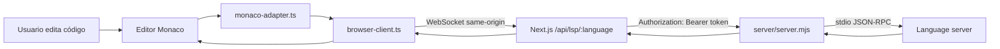
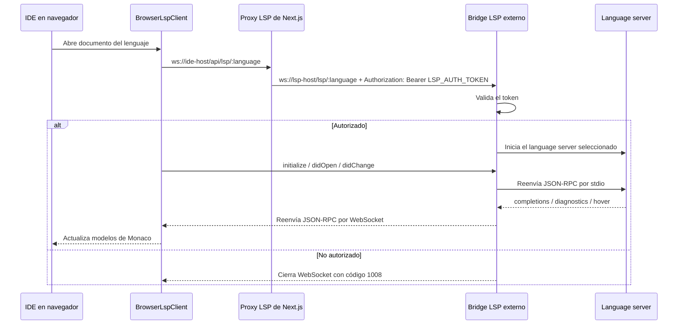

# Runtime LSP de Vibe IDE

[English](README.md) · [Español](README.es.md)

Runtime de inteligencia de lenguaje para Vibe Judge IDE. Este repositorio contiene el cliente/adaptador LSP de Monaco para el navegador y un puente Dockerizado WebSocket-a-stdio que inicia servidores de lenguaje reales.

Úsalo cuando el IDE necesite autocompletado, diagnósticos, hover y comportamiento de editor con soporte de lenguaje para Java, C++, Python, JavaScript/TypeScript, Rust y Go.

## Qué Incluye

- Cliente LSP para Monaco en el navegador (`browser-client.ts`).
- Adaptador de Monaco para registrar autocompletado, hover y diagnósticos (`monaco-adapter.ts`).
- Configuración por lenguaje en `integrations/`.
- Puente Node.js WebSocket-a-stdio en `server/server.mjs`.
- Imagen Docker con language servers y runtimes necesarios.
- Cache local opcional de archivos para acelerar rebuilds de Docker.

## Lenguajes Soportados

| Ruta | Language server |
| --- | --- |
| `/lsp/java` | Eclipse JDT Language Server (`jdtls`) |
| `/lsp/cpp` | `clangd` |
| `/lsp/python` | `pyright-langserver --stdio` |
| `/lsp/js` | `typescript-language-server --stdio` |
| `/lsp/rust` | `rust-analyzer` |
| `/lsp/go` | `gopls serve` |

## Arquitectura

El navegador no debe conectarse directamente al bridge LSP externo. En la integración esperada del IDE, el navegador se conecta a un proxy same-origin de Next.js (`/api/lsp/:language`). Ese proxy reenvía la conexión WebSocket al bridge y agrega el header privado `LSP_AUTH_TOKEN` desde el servidor.





## Estructura Del Repositorio

| Ruta | Propósito |
| --- | --- |
| `browser-client.ts` | Cliente LSP por WebSocket usado por el IDE en el navegador. |
| `monaco-adapter.ts` | Conecta modelos, diagnósticos, hover y completions de Monaco con el cliente LSP. |
| `integrations/` | Configuración Monaco/LSP por lenguaje. |
| `protocol.ts`, `types.ts`, `document-uri.ts` | Helpers compartidos de protocolo, tipos y URI. |
| `server/server.mjs` | Puente Node WebSocket-a-stdio. |
| `server/package.json` | Paquete runtime del bridge dentro del contenedor. |
| `server/workspace/` | Workspace montado por defecto para los language servers. |
| `Dockerfile` | Instala language servers y runtimes necesarios. |
| `docker-compose.yml` | Ejecuta el bridge en el puerto `3001` y monta `/workspace`. |
| `storage/` | Cache local opcional para archivos de Go, Java y JDTLS. |

## Inicio Rápido

### 1. Configura el secreto del bridge

Crea o actualiza `.env` en este repositorio:

```env
LSP_AUTH_TOKEN="dev-lsp-token"
```

`LSP_AUTH_TOKEN` es obligatorio. El bridge se niega a iniciar sin ese valor.

### 2. Inicia el bridge

Desde este repositorio:

```bash
docker compose up --build
```

Si este repositorio está montado como carpeta `lsp/` dentro del repositorio principal del IDE, el comando equivalente desde el padre puede ser:

```bash
npm run lsp:up
```

El bridge escucha en `http://localhost:3001` y expone rutas WebSocket protegidas por token bajo `/lsp/:language`.

### 3. Verifica salud

```bash
curl http://localhost:3001/healthz
```

Respuesta esperada:

```json
{"ok":true,"languages":["java","cpp","python","js","rust","go"]}
```

### 4. Configura el proxy del IDE

En la aplicación principal del IDE, apunta el cliente del navegador a rutas proxy same-origin y configura el proxy del servidor con la URL/token privados del bridge:

```env
NEXT_PUBLIC_LSP_JAVA_WS="/api/lsp/java"
NEXT_PUBLIC_LSP_CPP_WS="/api/lsp/cpp"
NEXT_PUBLIC_LSP_PYTHON_WS="/api/lsp/python"
NEXT_PUBLIC_LSP_JAVASCRIPT_WS="/api/lsp/js"
NEXT_PUBLIC_LSP_RUST_WS="/api/lsp/rust"
NEXT_PUBLIC_LSP_GO_WS="/api/lsp/go"

LSP_AUTH_TOKEN="dev-lsp-token"
LSP_SERVER_WS_BASE="ws://127.0.0.1:3001"
```

No crees `NEXT_PUBLIC_LSP_AUTH_TOKEN`. Cualquier valor `NEXT_PUBLIC_*` se empaqueta en el navegador y no es secreto.

## Checks Locales Del Servidor

El paquete del bridge vive en `server/`:

```bash
cd server
npm install
npm run check
npm start
```

`npm run check` valida el bridge y scripts auxiliares con el verificador de sintaxis de Node.

## Builds Docker Más Rápidos

El Dockerfile puede instalar Go, Java y JDTLS desde archivos locales en `storage/` en vez de descargarlos en cada rebuild sin cache.

Llena el cache desde la raíz del repositorio:

```bash
node scripts/cache-runtime.mjs
```

Si este repo está dentro del repositorio principal del IDE, el comando del padre puede ser:

```bash
npm run lsp:cache
```

Los nombres esperados de los archivos están documentados en [`storage/README.md`](storage/README.md). Los volúmenes nombrados de Docker sirven en runtime, pero no están disponibles durante `docker build`; por eso el cache de build vive en `storage/`.

## Sobrescribir Comandos De Language Servers

Cada comando de language server se puede sobrescribir con variables de entorno:

| Lenguaje | Variables de comando |
| --- | --- |
| Java | `LSP_JAVA_COMMAND`, `LSP_JAVA_ARGS` |
| C++ | `LSP_CPP_COMMAND`, `LSP_CPP_ARGS` |
| Python | `LSP_PYTHON_COMMAND`, `LSP_PYTHON_ARGS` |
| JavaScript/TypeScript | `LSP_JAVASCRIPT_COMMAND`, `LSP_JAVASCRIPT_ARGS` |
| Rust | `LSP_RUST_COMMAND`, `LSP_RUST_ARGS` |
| Go | `LSP_GO_COMMAND`, `LSP_GO_ARGS` |

Ejemplo:

```bash
LSP_CPP_ARGS="--background-index --clang-tidy" docker compose up --build
```

## Notas Sobre Workspace

`docker-compose.yml` monta `server/workspace` como `/workspace` dentro del contenedor. Los documentos de Monaco deberían usar URIs de archivo dentro de ese workspace, por ejemplo:

```text
file:///workspace/main.cpp
file:///workspace/Main.java
```

JDTLS usa un workspace interno separado en `/tmp/jdtls-workspace`. Mantenlo fuera de `/workspace`; si no, JDTLS no puede crear su proyecto invisible para documentos Java de un solo archivo y completions como `Integer.` pueden volver vacías.

## Agregar Un Lenguaje

1. Instala el language server en `Dockerfile`.
2. Agrega el comando y la ruta en `server/server.mjs`.
3. Agrega una integración de navegador en `integrations/`.
4. Registra el endpoint en las variables de entorno y la ruta proxy del IDE.
5. Agrega configuración de lenguaje de Monaco si Monaco no la incluye.
6. Inicia el bridge y verifica `/healthz` más una solicitud real de autocompletado en el editor.

## Solución De Problemas

| Problema | Qué revisar |
| --- | --- |
| El bridge termina al iniciar | Confirma que `.env` o el entorno del contenedor tenga `LSP_AUTH_TOKEN`. |
| El WebSocket cierra con `1008` | Confirma que el proxy envíe `Authorization: Bearer <LSP_AUTH_TOKEN>` y use `/lsp/:language`. |
| El navegador expone o registra el token | Elimina cualquier `NEXT_PUBLIC_LSP_AUTH_TOKEN`; los secretos deben quedarse del lado servidor. |
| Java no muestra completions | Confirma que JDTLS arranca con Java 21+ y usa `/tmp/jdtls-workspace`. |
| Faltan includes de C++ | Agrega flags del proyecto a `server/workspace/compile_flags.txt` o sobrescribe `LSP_CPP_ARGS`. |
| Falta Rust o Go server | Reconstruye la imagen Docker y revisa los logs de instalación. |
| El rebuild Docker tarda mucho | Ejecuta `node scripts/cache-runtime.mjs` y reconstruye con el cache local. |
