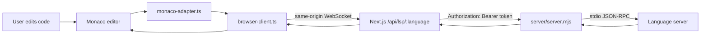
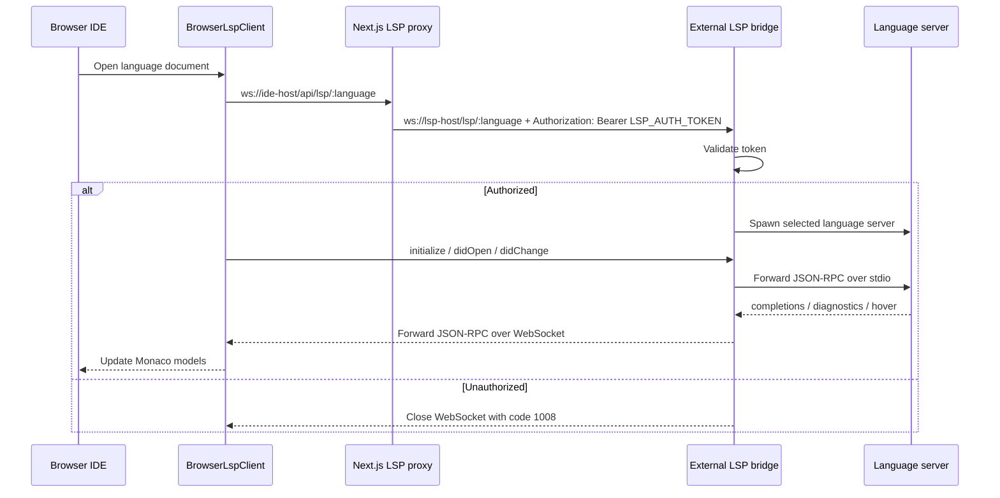

# Vibe IDE LSP Runtime

[English](README.md) · [Español](README.es.md)

Language intelligence runtime for the Vibe Judge IDE. This repository contains the browser-side Monaco LSP adapter plus a Dockerized WebSocket bridge that starts real language servers over stdio.

Use it when the IDE needs completions, diagnostics, hover information, and language-aware editor behavior for Java, C++, Python, JavaScript/TypeScript, Rust, and Go.

## What You Get

- A browser LSP client for Monaco (`browser-client.ts`).
- A Monaco adapter that registers completion, hover, and diagnostics providers (`monaco-adapter.ts`).
- Per-language integration defaults under `integrations/`.
- A Node.js WebSocket-to-stdio bridge in `server/server.mjs`.
- A Docker image with the required language servers and runtimes.
- Optional local archive caching for faster Docker rebuilds.

## Supported Languages

| Route | Language server |
| --- | --- |
| `/lsp/java` | Eclipse JDT Language Server (`jdtls`) |
| `/lsp/cpp` | `clangd` |
| `/lsp/python` | `pyright-langserver --stdio` |
| `/lsp/js` | `typescript-language-server --stdio` |
| `/lsp/rust` | `rust-analyzer` |
| `/lsp/go` | `gopls serve` |

## Architecture

The browser should not talk to the external LSP bridge directly. In the intended IDE setup, the browser connects to a same-origin Next.js proxy (`/api/lsp/:language`). That proxy forwards the WebSocket connection to this bridge and attaches the private `LSP_AUTH_TOKEN` header server-side.





## Repository Layout

| Path | Purpose |
| --- | --- |
| `browser-client.ts` | Browser WebSocket LSP client used by the IDE. |
| `monaco-adapter.ts` | Connects Monaco models, diagnostics, hover, and completions to the LSP client. |
| `integrations/` | Per-language Monaco/LSP integration settings. |
| `protocol.ts`, `types.ts`, `document-uri.ts` | Shared protocol, type, and URI helpers. |
| `server/server.mjs` | Node WebSocket-to-stdio bridge. |
| `server/package.json` | Runtime package for the bridge container. |
| `server/workspace/` | Default mounted workspace used by language servers. |
| `Dockerfile` | Installs language servers and required runtimes. |
| `docker-compose.yml` | Runs the bridge on port `3001` and mounts `/workspace`. |
| `storage/` | Optional local build cache for Go, Java, and JDTLS archives. |

## Quick Start

### 1. Configure the bridge secret

Create or update `.env` in this repository:

```env
LSP_AUTH_TOKEN="dev-lsp-token"
```

`LSP_AUTH_TOKEN` is required. The bridge refuses to start without it.

### 2. Start the bridge

From this repository:

```bash
docker compose up --build
```

If this repository is checked out as an `lsp/` folder inside the main IDE repository, the equivalent parent-repo command may be:

```bash
npm run lsp:up
```

The bridge listens on `http://localhost:3001` and exposes token-protected WebSocket routes under `/lsp/:language`.

### 3. Check health

```bash
curl http://localhost:3001/healthz
```

Expected response:

```json
{"ok":true,"languages":["java","cpp","python","js","rust","go"]}
```

### 4. Configure the IDE proxy

In the main IDE application, point the browser client at same-origin proxy routes and configure the server-side proxy with the private bridge URL/token:

```env
NEXT_PUBLIC_LSP_JAVA_WS="/api/lsp/java"
NEXT_PUBLIC_LSP_CPP_WS="/api/lsp/cpp"
NEXT_PUBLIC_LSP_PYTHON_WS="/api/lsp/python"
NEXT_PUBLIC_LSP_JAVASCRIPT_WS="/api/lsp/js"
NEXT_PUBLIC_LSP_RUST_WS="/api/lsp/rust"
NEXT_PUBLIC_LSP_GO_WS="/api/lsp/go"

LSP_AUTH_TOKEN="dev-lsp-token"
LSP_SERVER_WS_BASE="ws://127.0.0.1:3001"
```

Do **not** create `NEXT_PUBLIC_LSP_AUTH_TOKEN`. Any `NEXT_PUBLIC_*` value is bundled into the browser and is not secret.

## Local Server Checks

The bridge package lives under `server/`:

```bash
cd server
npm install
npm run check
npm start
```

`npm run check` validates the bridge and helper scripts with Node's syntax checker.

## Faster Docker Builds

The Dockerfile can install Go, Java, and JDTLS from local archives in `storage/` instead of downloading them on every uncached rebuild.

Populate the cache from the repository root:

```bash
node scripts/cache-runtime.mjs
```

If this repo is nested inside the main IDE repo, the parent command may be:

```bash
npm run lsp:cache
```

Expected archive names are documented in [`storage/README.md`](storage/README.md). Docker named volumes are useful at runtime, but they are not available during `docker build`; this is why build archives live under `storage/`.

## Override Language Server Commands

Every language server command can be overridden with environment variables:

| Language | Command variables |
| --- | --- |
| Java | `LSP_JAVA_COMMAND`, `LSP_JAVA_ARGS` |
| C++ | `LSP_CPP_COMMAND`, `LSP_CPP_ARGS` |
| Python | `LSP_PYTHON_COMMAND`, `LSP_PYTHON_ARGS` |
| JavaScript/TypeScript | `LSP_JAVASCRIPT_COMMAND`, `LSP_JAVASCRIPT_ARGS` |
| Rust | `LSP_RUST_COMMAND`, `LSP_RUST_ARGS` |
| Go | `LSP_GO_COMMAND`, `LSP_GO_ARGS` |

Example:

```bash
LSP_CPP_ARGS="--background-index --clang-tidy" docker compose up --build
```

## Workspace Notes

`docker-compose.yml` mounts `server/workspace` to `/workspace` in the container. Monaco documents should use file URIs inside that workspace, for example:

```text
file:///workspace/main.cpp
file:///workspace/Main.java
```

JDTLS uses a separate internal Eclipse workspace at `/tmp/jdtls-workspace`. Keep it outside `/workspace`; otherwise JDTLS cannot create its invisible project for single-file Java documents and completions such as `Integer.` can return empty results.

## Add a Language

1. Install the language server in `Dockerfile`.
2. Add the command and route to `server/server.mjs`.
3. Add a browser integration file under `integrations/`.
4. Register the endpoint in the IDE environment variables and proxy route.
5. Add Monaco language configuration if Monaco does not already include it.
6. Start the bridge and verify `/healthz` plus one real editor completion request.

## Troubleshooting

| Problem | Check |
| --- | --- |
| Bridge exits on startup | Confirm `.env` or the container environment provides `LSP_AUTH_TOKEN`. |
| WebSocket closes with `1008` | Confirm the proxy sends `Authorization: Bearer <LSP_AUTH_TOKEN>` and uses `/lsp/:language`. |
| Browser exposes or logs the token | Remove any `NEXT_PUBLIC_LSP_AUTH_TOKEN`; secrets must stay server-side. |
| Java completions are empty | Confirm JDTLS starts with Java 21+ and uses `/tmp/jdtls-workspace`. |
| C++ includes are missing | Add project-specific flags to `server/workspace/compile_flags.txt` or override `LSP_CPP_ARGS`. |
| Rust or Go server is missing | Rebuild the Docker image and inspect install logs. |
| Docker rebuild is slow | Run `node scripts/cache-runtime.mjs` and rebuild with the local archive cache. |
